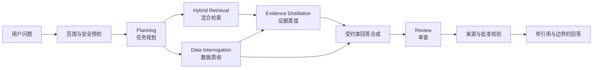

# HerbLens

### 植物食品与成分的循证营养健康 Agent

**查证一个健康说法，追溯一条成分关联，理解证据能够支持到哪里。**

`Python` · `LangGraph` · `LangChain` · `RAG` · `MCP` · `FastAPI` · `Pydantic` · `Vue 3` · `SSE`

> **项目展示仓库 / Portfolio showcase**
>
> 这里展示项目定位、工程设计与开发状态。核心实现和研究数据暂不公开，以配合毕业论文研究安排。本仓库不提供可运行源码、数据下载或公开在线服务。
>
> **状态（2026-10-19）**：已有领域问答、文献检索与证据约束原型及历史隔离验证。**五角色多 Agent 与关联探索是升级目标，尚未在本展示版本验收。**

## 项目解决什么问题

植物食品与植物来源成分的健康信息经常同时涉及材料形式、研究对象和证据等级。HerbLens 将问题理解、文献检索、结构化数据查询和回答约束组织在一起，让用户看到结论、来源及适用边界。

| 产品能力 | 用户希望了解什么 | 当前展示状态 |
|---|---|---|
| **健康说法核验** | 一个宣传说法有哪些研究支持？研究对象和材料形式是否匹配？ | 已有原型与历史本地隔离验证；真实人工批准范围和新版部署尚待验收 |
| **关联探索** | 食物含有哪些成分？成分涉及哪些健康研究？关联来自哪里？ | 已完成方向设计，真实关联资产与端到端功能待验收 |

## 工程重点

- **领域 RAG**：已有文献采集、身份核验、解析切分、中文词表映射、词法召回与证据重排；整理 19,385 篇完整摘要、21,080 个窗口并完成离线向量编码。在线向量与混合检索仍需实际可用性验收。
- **论断级证据约束**：将允许论断与审核决定、完整原文窗口关联；通过窗口哈希和支持原句核验依据，保持召回、元数据修订与回答绑定的决定源一致。历史隔离验证不等于真实科学批准。
- **工具执行与恢复**：另实现 MCP 工具发现、网页获取及受控研究任务模块，涉及工具白名单、参数与授权范围校验、有限重试、人工确认和检查点恢复；该模块不表述为默认问答五角色主链已经接通。
- **全栈交互**：基于 Vue 3、FastAPI 和 SSE 实现已有问答及结果卡，展示引用、边界与失败状态。升级版将增加关联路径及真实角色执行摘要。

## 五角色升级架构 · Planned

目标运行时采用五个专业角色，根据任务选择执行，而不是每个问题固定调用全部角色。

| 角色 | 目标职责 |
|---|---|
| Planning | 分解问题、选择子任务，并在预算内调整计划 |
| Hybrid Retrieval | 选择检索策略、有限改写查询，显式记录后端降级 |
| Evidence Distillation | 整理研究对象、材料形式、支持片段、冲突与限制 |
| Data Interrogation | 实体消歧、只读关联查询，以及数据可比性检查 |
| Review | 检查引用、对象错配与无依据推断，提出有界修订 |

**模型审查不代替人工科学批准。食物含有某成分，也不意味着食用该食物具有该成分研究中的效果。**

## 深入了解

- [架构与模块边界](docs/architecture.md)
- [两项功能的交互示意](docs/case-study.md)
- [验证状态与适用限制](docs/validation.md)

## 个人职责

由 **[zhaohy0601](https://github.com/zhaohy0601)** 主导领域改造、工作流设计、数据与证据接入、前后端集成及验证。项目基于开源工程骨架演进，不宣称底层全部从零实现。

## 公开范围与致谢

本仓库只公开展示材料，不包含核心源码、完整提示词、语料、关系数据包、人工审核记录或毕业论文实验细节。源码开放时间尚未确定。

工程骨架来源于 [SmartDietian](https://github.com/Givenchy-Coisini/SmartDietian)；循证检索设计参考 [PaperQA](https://github.com/Future-House/paper-qa)；关联探索设计参考 [FoodAtlas](https://github.com/AI-Institute-Food-Systems/foodatlas)。参考关系不代表已经集成这些项目的框架或数据。

参见 [NOTICE](NOTICE.md)。本项目用于信息探索与证据解读，不提供医疗诊断、治疗或剂量建议。
