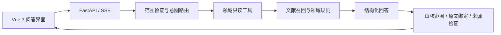

# 架构与模块边界

更新：2026-10-19。以下将已有原型与目标设计分别说明，不发布核心实现细节。

## 已有原型

已有主问答是带工具调用的单 Agent 与确定性工作流组合。多个图节点、模型调用或工具不自动等于多 Agent。

文献库与离线向量资产可用于检索开发；真实请求使用了什么召回后端，需要按实际执行确认。研究探索与默认消费者回答采用不同证据边界，待审材料不自动成为允许功效论断。

## 目标：五角色协作

目标角色为 Planning、Hybrid Retrieval、Evidence Distillation、Data Interrogation 和 Review。各角色通过结构化任务和结果交换信息，工具权限按职责限制。

- 核验任务以文献检索和证据整理为主。
- 关联任务以实体和关系查询为主，需要研究解释时再检索文献。
- 无依赖任务可以并行；补查和修订受总预算与终止条件控制。
- 合成是受约束节点；科学批准、来源绑定和确定性安全规则不交给模型自行放行。

## 数据与回答边界

目标关联记录分别保留实体、关系类型、原始来源和材料限定条件。实际数据覆盖、许可与版本需在引入时核实，当前展示不承诺已经取得完整外部图谱。

关联路径说明“哪些记录相连”，不自动证明因果。某食品含成分、某成分与疾病有关联，不能据此生成食品预防或治疗该疾病的结论。

## 可观察执行

已有 SSE 用于传输回答与状态。目标版本将展示实际角色及工具执行摘要，不公开模型隐藏推理。模型不可用、检索降级、来源不足或取消，应作为可见状态处理。

本仓库不包含私有 API 契约、提示词、模型参数、部署拓扑或生产访问凭据。
